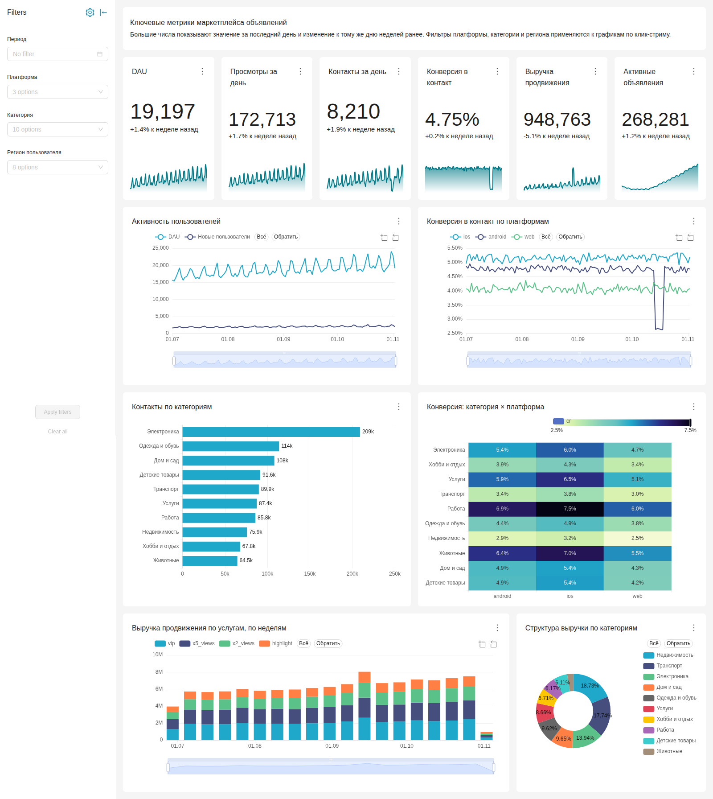
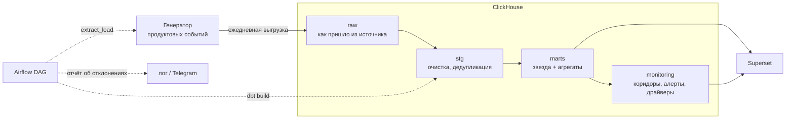
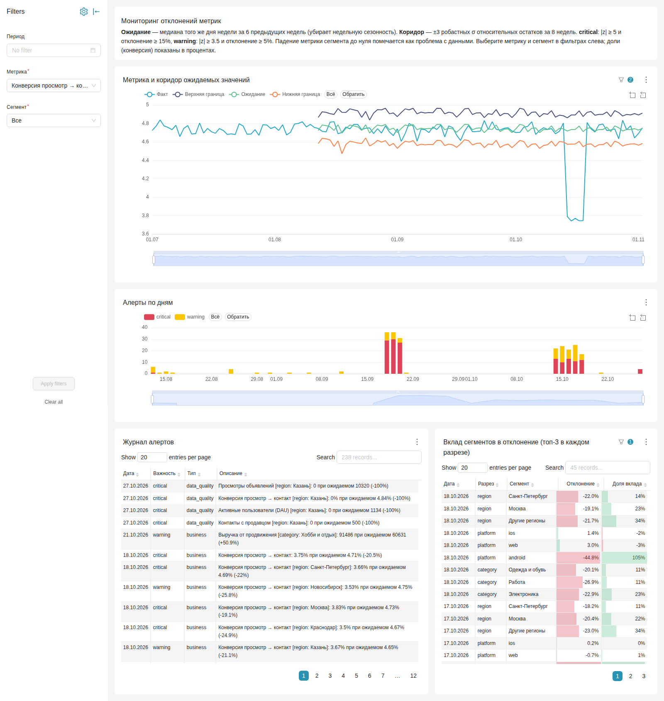
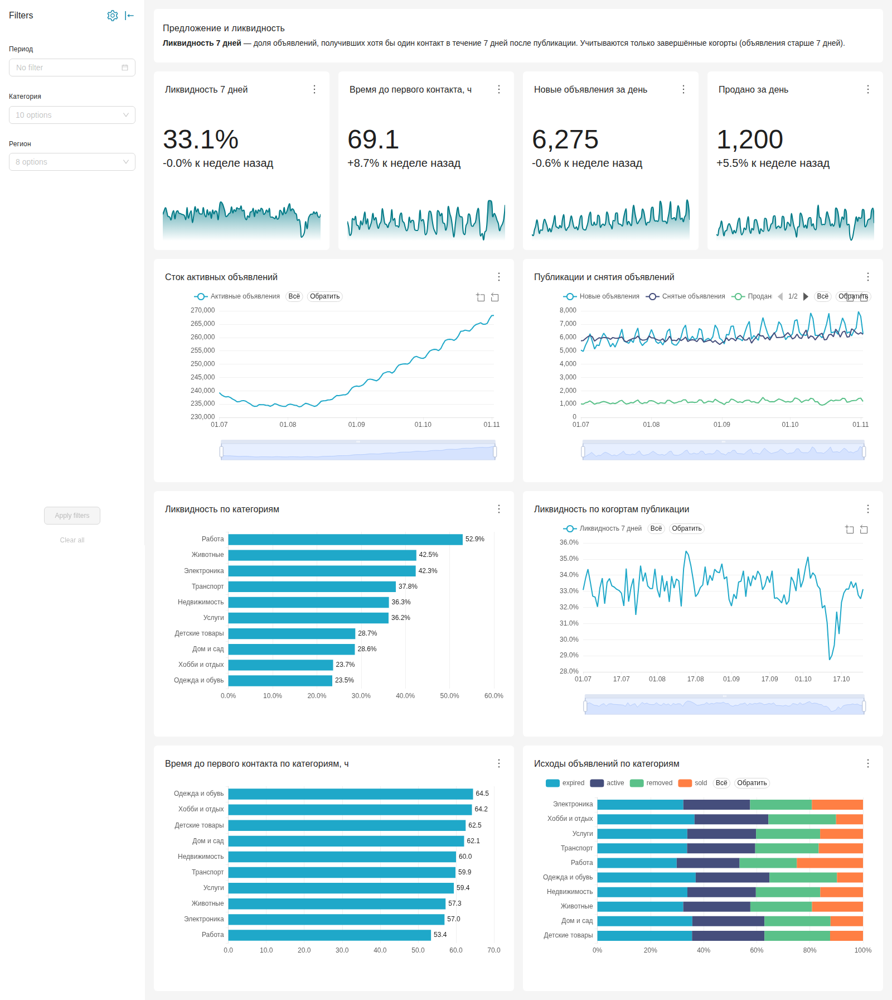

# Classifieds Analytics Platform

BI-платформа для маркетплейса объявлений: хранилище в ClickHouse, ETL на Airflow и dbt, дашборды в Superset и автоматический мониторинг отклонений метрик с поиском причины.

Данные синтетические, но генератор моделирует реальное поведение: сезонность по дням недели, рост аудитории, разные конверсии по категориям и платформам, дубли в клик-стриме. В историю специально заложены три инцидента. Мониторинг находит их сам, без подсказок (см. [кейс](#кейс-упала-конверсия-в-контакт)).



## Стек

| Задача | Инструмент |
|---|---|
| Хранилище | ClickHouse 26.8 |
| Трансформации и тесты данных | dbt-core 1.12 + dbt-clickhouse |
| Оркестрация | Airflow 3.3 |
| Дашборды | Superset 6.0 (дашборды описаны кодом) |
| Источник данных | Python, numpy, pandas |
| Инфраструктура | Docker Compose, Make |

## Архитектура



Ежедневный DAG `marketplace_daily`:

```
extract_load → dbt_staging → dbt_marts → dbt_monitoring → report_alerts
```

Каждый шаг идемпотентен. Сырые таблицы партиционированы по дате загрузки, поэтому перезагрузка дня — это атомарная замена партиции. Инкрементальные модели dbt перезаписывают последние партиции (`insert_overwrite`). Любой запуск можно безопасно перезапустить.

## Модель данных

**Источник (raw):** `users`, `listings`, `listing_closures`, `events` (просмотр / контакт / избранное), `promotions` (платное продвижение), `load_log`.

**Витрины (marts):**

| Модель | Грейн | Назначение |
|---|---|---|
| `dim_users`, `dim_listings`, `dim_date` | сущность | Измерения: регион, платформа, категория, статус и срок жизни объявления |
| `fct_events` | событие | Клик-стрим без дублей, обогащённый атрибутами (инкрементальная) |
| `fct_promotions` | платёж | Оплаты продвижения |
| `agg_daily_kpi` | день | DAU, просмотры, контакты, конверсия, сток объявлений, выручка, ARPPU |
| `agg_daily_slice` | день × платформа × категория × регион | Аддитивные метрики для разрезов |
| `listing_liquidity` | когорта публикации × категория × регион | Ликвидность за 7 дней, время до первого контакта |

**Тесты:** 36 проверок dbt. Уникальность и полнота ключей, ссылочная целостность фактов и измерений, допустимые значения, свежесть источника. Отдельные тесты проверяют, что в дневных KPI нет пропущенных дней, что контактов не больше, чем просмотров, и что сток объявлений положительный.

## Метрики

Описания хранятся в `dbt/seeds/metric_catalog.csv` и в семантическом слое датасетов Superset, поэтому метрика везде считается одинаково.

| Метрика | Расчёт |
|---|---|
| DAU | уникальные пользователи с событием за день |
| Конверсия просмотр → контакт | `contacts / views` (отношение сумм, а не среднее дневных долей) |
| Ликвидность 7 дней | доля объявлений, получивших контакт в течение 7 дней после публикации; только завершённые когорты |
| Время до первого контакта | медиана часов до первого контакта в том же 7-дневном окне |
| Активные объявления | сток на конец дня: все опубликованные минус все снятые |
| Выручка продвижения, ARPPU | сумма оплат; выручка / число платящих продавцов |

Два места, где легко ошибиться:

- Время до первого контакта считается только по контактам внутри 7-дневного окна. Иначе у свежих когорт успевают прийти только быстрые контакты, и метрика выглядит лучше, чем есть на самом деле (цензурирование).
- В `agg_daily_slice` поле `users` — distinct count. Его нельзя суммировать между строками, поэтому DAU в разрезах считается из `fct_events`.

## Мониторинг отклонений

Каждая метрика отслеживается в целом и в разрезах по платформе, категории и региону (`monitoring.metric_daily`).

1. **Ожидание** — медиана того же дня недели за 6 предыдущих недель. Сравнение с тем же днём недели убирает недельную сезонность, а медиана не даёт одному прошлому инциденту сдвинуть базу.
2. **Типичная ошибка** — робастный разброс (1.4826 × MAD) относительных остатков `факт / ожидание − 1` за 8 недель. Мелкие шумные сегменты автоматически получают более широкий коридор, а отставание медианы от тренда роста попадает в оценку разброса.
3. **Статус:** `critical` при |z| ≥ 5 и отклонении ≥ 15%, `warning` при |z| ≥ 3.5 и отклонении ≥ 5%.
4. **Тип:** если объёмная метрика сегмента упала ровно до нуля, алерт помечается как `data_quality`. Так почти никогда не ведут себя пользователи, но так выглядит сбой доставки данных.
5. **Декомпозиция** (`alert_drivers`): для каждого алерта на общей метрике считается вклад каждого сегмента. Для аддитивных метрик это `факт − ожидание` сегмента. Для долей это вес сегмента × изменение его доли.

Первая версия детектора оценивала разброс по 6 точкам и давала около 800 ложных срабатываний в сегментах. После перехода на MAD остатков за 8 недель за три обычных месяца нет ни одного ложного алерта на уровне общих метрик.

### Результат на заложенных инцидентах

| Инцидент | Что нашёл мониторинг |
|---|---|
| Акция «−50% на продвижение», 18–20 сентября | покупки продвижения +230%, выручка +63%, `critical` |
| Релиз Android сломал кнопку «Написать», 14–18 октября | конверсия −21% в целом, −44% на Android, `critical`; 100% отклонения объясняется Android |
| Потеря клик-стрима из Казани, 27 октября | все метрики Казани упали до нуля, помечены как `data_quality`; на общих метриках это лишь −6%, в пределах шума |

### Кейс: упала конверсия в контакт

15 октября конверсия просмотр → контакт составила 3.74% при ожидаемых 4.73%. Ежедневный DAG присылает такой отчёт:

```
Главный вклад в «Конверсия просмотр → контакт»: platform = android (100% отклонения)
Главный вклад в «Контакты с продавцом»: platform = android (95% отклонения)
[critical] Конверсия просмотр → контакт: 3.74% при ожидаемом 4.73% (-20.9%)
[critical] Конверсия просмотр → контакт [platform: android]: 2.68% при ожидаемом 4.76% (-43.7%)
...
```

По категориям и регионам падение распределено пропорционально их весу, по платформам оно целиком сосредоточено на Android. Значит, проблема не в спросе и не в отдельной категории, а в приложении. Первым делом стоит проверить, какой релиз Android вышел 14 октября. Без декомпозиции тот же сигнал выглядел бы как 30+ отдельных алертов по всем категориям и регионам.



## Дашборды

Все три дашборда, их графики, датасеты, метрики и фильтры создаются скриптом `superset/bootstrap/` через REST API Superset. Изменение дашборда — это изменение кода, оно проходит ревью и воспроизводится на чистой установке.

- **Маркетплейс: ключевые метрики** — KPI с динамикой к прошлой неделе, конверсия по платформам, категории, выручка продвижения по услугам.
- **Объявления и ликвидность** — сток, публикации и снятия, ликвидность по категориям и когортам, исходы объявлений.
- **Мониторинг метрик** — факт и коридор для выбранной метрики и сегмента, алерты по дням, журнал алертов, вклад сегментов.



## Запуск

Нужны Docker с Compose, около 4 ГБ памяти для Docker и 6 ГБ на диске под образы.

```bash
make init
```

Команда поднимает сервисы, генерирует историю с 1 июля по вчерашний день (~23 млн событий), собирает витрины dbt и создаёт дашборды. На ноутбуке это около 5 минут плюс первое скачивание образов. Генератор детерминирован (случайность зависит от даты), поэтому цифры из этого README воспроизводятся на любой машине.

| Сервис | Адрес | Доступ |
|---|---|---|
| Superset | http://localhost:8088 | admin / admin |
| Airflow | http://localhost:8080 | без логина |
| ClickHouse | http://localhost:8123 | bi / bi_password |

Другие команды:

```bash
make dbt-build     # инкрементальная сборка витрин и тесты
make dashboards    # пересоздать дашборды из кода
make screenshots   # снять скриншоты дашбордов (Playwright)
make ch            # консоль ClickHouse
make reset         # удалить всё вместе с данными
```

Чтобы получать отчёт об отклонениях в Telegram, задайте `TELEGRAM_BOT_TOKEN` и `TELEGRAM_CHAT_ID` в окружении Airflow.

## Структура

```
generator/            синтетический источник: модель маркетплейса и загрузка в raw
clickhouse/init/      DDL сырого слоя
dbt/models/staging/   очистка и дедупликация
dbt/models/marts/     измерения, факты, агрегаты
dbt/models/monitoring/ метрики в длинном формате, коридоры, алерты, драйверы
dbt/seeds/            каталог метрик
airflow/dags/         ежедневный DAG
superset/bootstrap/   дашборды как код
scripts/              скриншоты дашбордов
```
